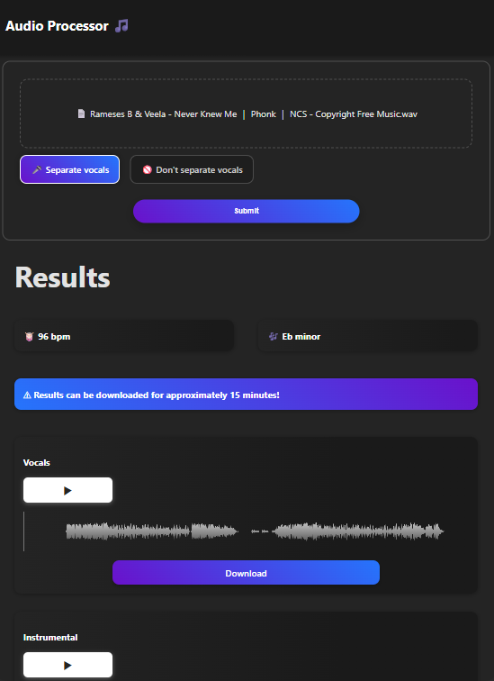
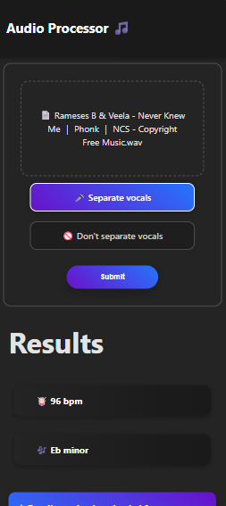
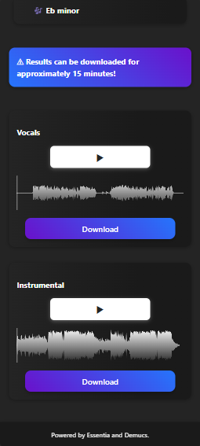

# Music analysis software

[full thesis here](https://urn.fi/URN:NBN:fi:amk-202604298423)

The main objective of this thesis was to identify what kind of information is commonly required to rearrange or sample an existing musical piece. The goal was
to create an effective tool that would ease the difficulties in remixing and sampling
and to offer a method to easily retrieve commonly needed music information,
such as tempo and key, while simultaneously offering a way to separate vocals
from the original track.

This thesis focuses on the basic musical features and the most important terms
in music theory to help better understand the common practices of music analysis
processes and stem separation technology. This is important since it also helps
to understand how the technologies used in the application, such as Essentia and
Demucs, function.

As a result of this thesis, a web application was created using React as its
frontend and Python as the backend. The whole process of creating a working
full-stack application is documented in detail. Also, some of the alternative technologies that could have been used in the application are discussed.

Towards the end of the thesis, problems during development were also discussed
alongside the possibilities of developing the application even further.

# Images

